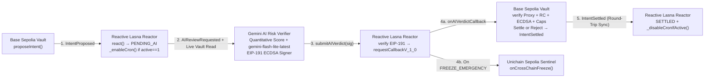

# SynapseGuard Protocol Architecture

**SynapseGuard** implements a **bidirectional verifiable AI ↔ Reactive Omni loop** connecting **Base Sepolia (`84532`)**, **Reactive Lasna (`5318007`)**, **Unichain Sepolia (`1301`)**, and an off-chain **Google Gemini (`gemini-flash-lite-latest`) Risk Reviewer** with cryptographic EIP-191 ECDSA accountability.

---

## 1. Deployed Contracts (Sourcify Verified)

| Contract | Chain | Chain ID | Address | Role |
|---|---|---:|---|---|
| `SynapseReactor` | Reactive Lasna | `5318007` | `0xC2c5A2d58024F985E3060875590b4693d789559B` | Coordinator: ingests origin logs, runs lazy `Cron10`, validates ECDSA AI verdicts, dispatches dual-chain callbacks via `SYSTEM.requestCallbackV_1_0` |
| `SynapseGuardVault` | Base Sepolia | `84532` | `0x6B81f6C156e6AbdA4040E5534813736d8acf5BEd` | Origin + Destination Vault: escrows intents using `block.timestamp`, enforces proxy/RC/ECDSA + caps, settles assets, emits round-trip `IntentSettled` |
| `SynapseUnichainSentinel` | Unichain Sepolia | `1301` | `0x26D8Cdb8F670f46188270255D58aba211f848b31` | Correlated cross-chain emergency circuit breaker locked/unlocked atomically from Lasna |
| `DemoToken (sUSD)` | Base Sepolia | `84532` | `0x26D8Cdb8F670f46188270255D58aba211f848b31` | Open-faucet testnet ERC-20 collateral token |

Reactive Omni System & Proxies:
- Reactive Lasna `SYSTEM`: `0x8888888888888888888888888888888888888888`
- Reactive Legacy Cron Emitter (`Cron10`): `0x0000000000000000000000000000000000fffFfF` (`topic0 = 0x04463f7c1651e6b9774d7f85c85bb94654e3c46ca79b0c16fb16d4183307b687`)
- Base Sepolia Callback Proxy: `0x476F44b11F5C942c58f4c8E3d0300E5710743585`
- Unichain Sepolia Callback Proxy: `0x775c9B990ADe401060B78D0e98684eEf8d2466C1`

---

## 2. Bidirectional Cross-Chain Lifecycle

### Failure Mode Guarantees

1. **Zero Silent Lasna <-> Destination Desynchronization**
   - Unlike naive reactive coordinators that mark local state finalized immediately upon submitting an AI verdict, `SynapseReactor` moves to intermediate `AI_DISPATCHED` and awaits `IntentSettled(intentId, outcome, executed, settledAt, modelDigest)` emitted back from Base Sepolia.
   - If an on-chain destination guardrail (`EXCEEDS_ONCHAIN_CAP`, `INSUFFICIENT_VAULT_LIQUIDITY`, `EXPIRED_TIMESTAMP`, `VAULT_ALREADY_FROZEN`) overrides an AI approval on Base Sepolia, `SynapseGuardVault` **does not revert** (protecting callback reserve economics) and emits `IntentSettled(OUTCOME_REJECTED_GUARDRAIL)`, synchronizing `SynapseReactor` cleanly back to `SETTLED`.

2. **Lazy `Cron10` Economics & AI-Offline Watchdog**
   - Reactive contracts only subscribe to `Cron10` (`~10s` cadence) when `_activeIntentIds.length` transitions from `0 -> 1`, and unsubscribe when `_activeIntentIds.length` transitions `1 -> 0` using the exact 6-argument subscription tuple.
   - If the off-chain Gemini reviewer stalls or crashes past `intent.deadlineTs`, `SynapseReactor` sweeps expired `PENDING_AI` records in `Cron10` (bounded batch `MAX_CRON_SWEEP_BATCH = 20`), dispatches `onTimeoutFallbackCallback`, unlocks escrow on Base Sepolia, and auto-syncs `TIMED_OUT` back to Lasna.

3. **200ms Block Compatibility & Replay Protection**
   - Base Sepolia produces blocks every `~200ms`. All deadlines and expiries (`ttlSeconds`, `deadlineTs`, `expiryTs`) operate strictly on `block.timestamp`.
   - Every AI signature hashes `abi.encode(destChainId, vaultAddress, intentId, decision, riskScoreBps, expiryTs, modelDigest)` inside EIP-191 `toEthSignedMessageHash`, preventing cross-chain, cross-contract, or intent-ID replay attacks.

4. **Defense-in-Depth AI + Deterministic Guardrails**
   - Off-chain evaluation extracts live Vault utilization (`amount / vaultLiquidity`), policy cap ratios, and anomaly hints before invoking `gemini-flash-lite-latest` with strict JSON schema output.
   - Extreme cap/drain exploits trigger a fail-closed guardrail check off-chain AND hard `onlyServiceProvider` + `onlyCallbackSender` + ECDSA + cap/liquidity checks on-chain.
